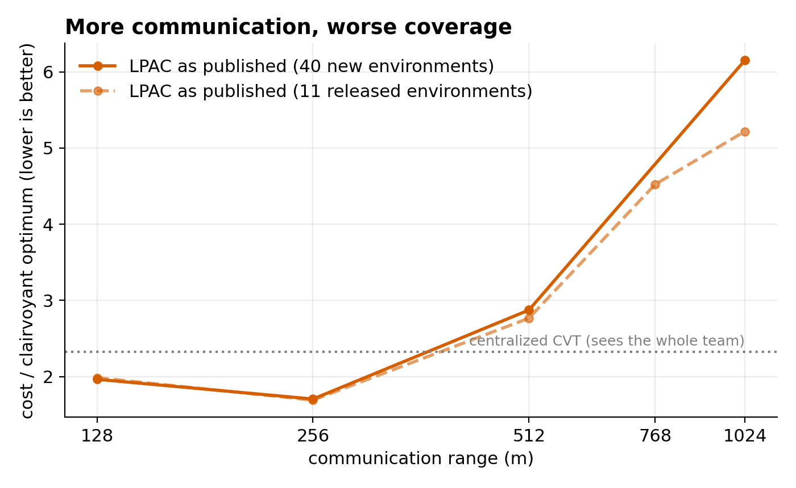
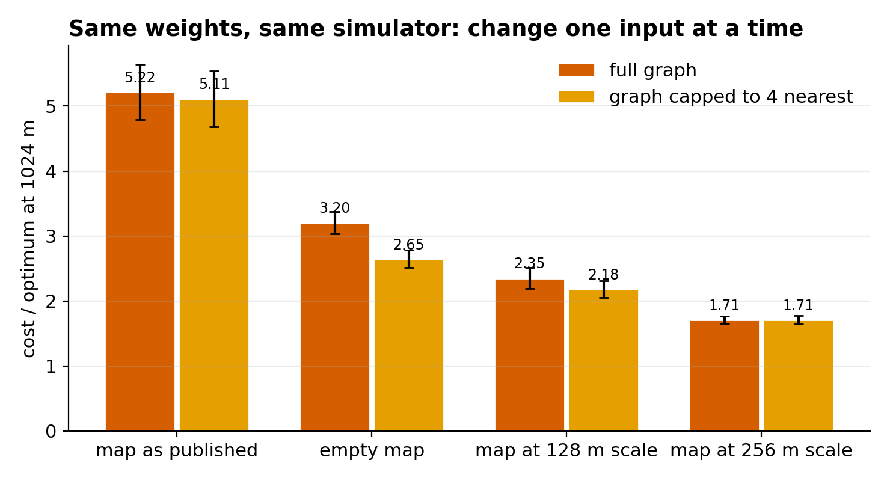
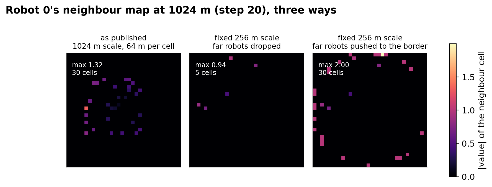
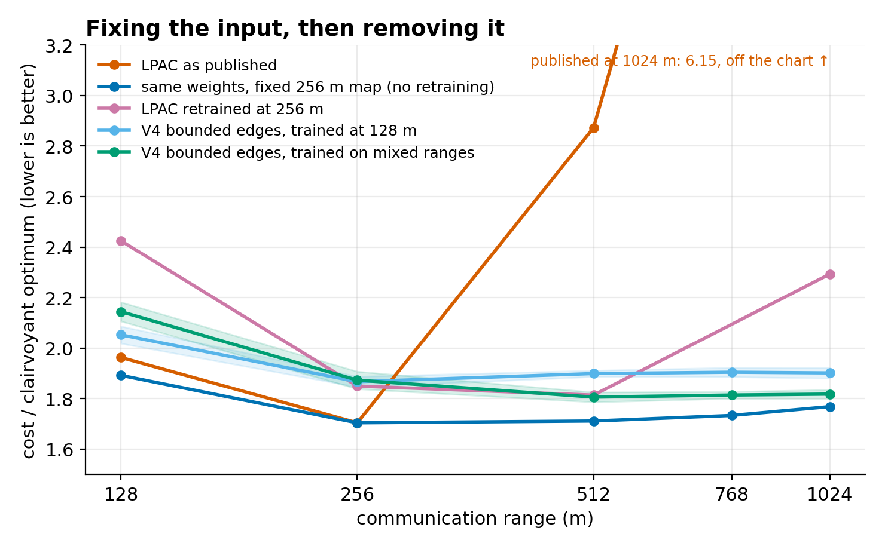
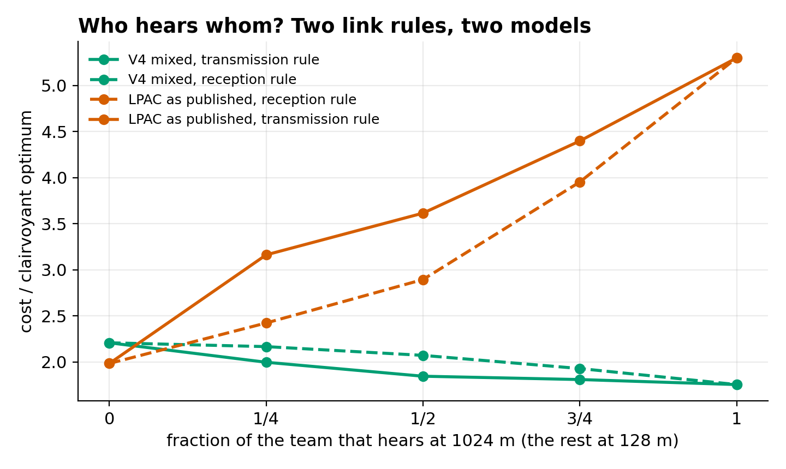
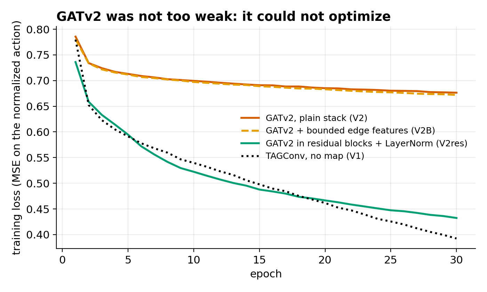

# When More Communication Hurts: Debugging a Graph Neural Network for Robot Swarms

*A published GNN controller gets 3.6 times worse when its robots can talk farther. We traced the failure to a single input image, fixed it without retraining, and built a model whose cost keeps falling as the range grows.*

By Loïc Poisson, Harold Gardon and Claire Fitussi, as part of Stanford CS224W (Machine Learning with Graphs), Autumn 2026.

<!-- FIGURE 0: figures/fig0_hook.gif
Caption: The same 32 robots and the same trained network in the same environment, with a communication range of 1024 m. Left: the controller as published. Right: one input image redrawn at a fixed scale, with no retraining. The number is the coverage cost divided by an all-knowing optimum (lower is better). -->

---

## The paradox

Give a team of robots better radios and they should do at least as well as before. A robot that hears more of its teammates knows more, and a controller can always choose to ignore what it does not need.

We took a state-of-the-art graph neural network controller for robot swarms, LPAC [1], and ran its published checkpoint at five communication ranges. At 256 m it does very well: its coverage cost is 1.70 times that of an all-knowing controller, far better than a classical centralized algorithm (2.33). At 1024 m, where every robot can hear almost the whole team, the cost climbs to **6.15**. That is 3.6 times worse, and much worse than the classical baseline it beat a moment ago.

This post is the story of finding out why. The short answer is that the graph was never the problem. The neighbourhood enters the model twice, once as the edges of the GNN and once as a small picture of where the neighbours are, and it is the picture that breaks. Along the way we found a free fix, a model that actually improves as the range grows, a result about how links should be defined when robots have different radios, and a diagnosis of why a GATv2 variant would not train.

All code runs in the accompanying Colab, and every number below is in an interactive report: [loicpoisson.github.io/lpac-range-transfer](https://loicpoisson.github.io/lpac-range-transfer/).

## The problem: coverage control as a graph problem

**Coverage control.** Thirty-two robots are dropped into a 1024 m × 1024 m world. Somewhere in it is an *importance density*: think of where wildfire smoke, survivors or crop disease are most likely to be. The robots must spread out so that every point of the world is close to a robot, weighted by its importance. The *coverage cost* measures how far, on average, important points are from their nearest robot. Lower is better.

If one robot knew the whole density, the answer would be a classical algorithm: Lloyd's algorithm on the Voronoi cells, called CVT (centroidal Voronoi tessellation). Each robot repeatedly moves to the weighted centre of the region it is closest to. We use a *clairvoyant* CVT, which knows the full density and every position, as the yardstick, and report every cost as a ratio to it, averaged over a 600-step episode. A ratio of 1.0 would be perfect.

The catch is that no robot knows the density. Each one only senses a 64 m × 64 m footprint around itself and remembers what it has seen. To do well it must learn about the rest of the world from its neighbours.

**Why a graph.** This is where graphs come in. Each robot is a node. Two robots share an edge when they are closer than the communication range *R*. The graph changes at every step as the robots move, and its density depends directly on *R*: at 128 m a robot has 1.4 neighbours on average, at 256 m about 4.5, and at 1024 m about 25.

**LPAC.** LPAC (Learnable Perception-Action-Communication loops) [1] is a three-stage network that runs on every robot:

1. **Perception, a CNN.** It reads four 32 × 32 images centred on the robot: the importance it has sensed in a 256 m × 256 m window around it (8 m per cell), two channels describing where its neighbours are (more on these below), and an obstacle map. It outputs a 32-number feature vector, to which the robot's position is appended.
2. **Communication, a GNN.** Five `TAGConv` layers [2] with K = 3 and width 256 pass these features along the communication graph. Each layer mixes information from up to three hops, so a robot's output depends on robots up to 15 hops away.
3. **Action, an MLP.** It turns the GNN output into a velocity.

The network is trained by imitation: it learns to reproduce what the clairvoyant CVT would do, from data where it cannot see what the clairvoyant sees. The released checkpoint has 1.8 million parameters and was trained with *R* = 128 m.

<!-- FIGURE: architecture diagram (export the site's SVG). CNN path in amber, GNN path in teal. -->

In PyTorch Geometric the communication stage is a few lines. The graph is a radius graph over robot positions, and the GNN is a stack of `TAGConv` layers:

```python
from torch_geometric.nn import TAGConv, radius_graph

edge_index = radius_graph(pos, r=comm_range)       # robots within R of each other
for conv in convs:                                  # 5 x TAGConv(256, 256, K=3)
    x = torch.relu(conv(x, edge_index))
```

**The detail that matters.** Two of the four CNN channels form a *neighbour map*: a 32 × 32 picture in which every neighbour within range is drawn at its relative position. The picture always spans 2*R* across, so each cell covers *R*/16 metres. At 128 m a cell is 8 m wide and the map shows one or two robots close up. At 1024 m the same 32 × 32 grid covers the whole world, 64 m per cell, and shows about 25 robots. The value written in each cell is the offset to the neighbour divided by *R*.

Keep that in mind: one input of the network changes its meaning with the communication range.

## The anomaly

We ran the published checkpoint, with the authors' own code (release v1.3.1) and their 11 evaluation environments, at five ranges. Then we generated 40 new environments with the library's own generator and ran everything again, so that no conclusion rests on 11 maps.


*Figure 1. Cost of the published model against the communication range, on the 11 released and the 40 new environments. The dotted line is a centralized CVT that sees the whole team.*

| Range | 128 m | 256 m | 512 m | 768 m | 1024 m |
|---|---|---|---|---|---|
| LPAC as published, 40 new environments | 1.96 | **1.70** | 2.87 | n/a | **6.15** |
| LPAC as published, 11 released environments | 1.98 | **1.69** | 2.77 | 4.52 | **5.22** |
| Centralized CVT | 2.33 | 2.33 | 2.33 | 2.33 | 2.33 |

The cost is best at 256 m and then explodes. The collapse appears in every single environment: the ratio between 1024 m and 256 m ranges from 2.1 to 4.6. At 768 and 1024 m the robots end the episode in a *worse* configuration than the one they started in.

Before looking for a deep explanation, we ruled out the boring ones:

* **Not a bug in our evaluation.** The simulator is deterministic: the same episode gives the same cost to the last digit across Intel machines. (It does not on AMD nodes, where costs differed by up to 5.6 % per environment; we discarded those runs.)
* **Not a quirk of the released checkpoint.** We retrained LPAC ourselves with the authors' recipe (100,000 samples at 128 m, 2 h 35 on one GPU), three times with different seeds. All three reproduce the collapse.
* **Not over-smoothing.** The textbook suspect when a GNN gets worse on denser graphs is over-smoothing: node features becoming identical. We measured the effective rank of every `TAGConv` layer's output. It drops by about 30 % at long range but never collapses.

One more measurement pointed the way. If we increase the range but shrink the team so that each robot keeps 4 to 5 neighbours, the collapse disappears. So the problem is tied to *how many neighbours the robots see*. But it enters the model in two places, the GNN's graph and the CNN's neighbour map. Which one?

## Diagnosis: is it the graph, or the picture of the graph?

The neat thing about having the neighbourhood enter the model twice is that the two can be separated. At test time we kept the trained weights and the simulator untouched, and changed only what the model was *given*:

* **The graph.** Either every robot in range (as published), or only each robot's 4 nearest neighbours in range, made undirected.
* **The neighbour map.** As published; empty; drawn at the 128 m scale the model was trained on; or drawn at a fixed 256 m scale. In the last two, robots beyond the scale are left out.

That is a small factorial experiment, run at 1024 m on the 11 released environments:


*Figure 2. Same weights, same simulator, 1024 m. Each bar changes only the graph, the neighbour map, or both. Error bars are standard errors over environments.*

The result is unambiguous:

* **Changing the graph alone does nothing measurable.** Capping every robot to 4 neighbours moves the cost from 5.22 to 5.11, better in only 5 of 11 environments.
* **Changing the map alone recovers almost everything.** Drawn at a fixed 256 m scale, the map brings the cost to **1.71**, better in 11 of 11 environments. That is the model's own performance at 256 m.
* **An empty map beats the published one at long range** (3.20 against 5.22), even though at 256 m the map is clearly useful (removing it costs 0.7). At 1024 m the map is worse than no information at all.
* **The number of neighbours is not the whole story.** With about 4.5 neighbours in the map, the cost is 1.69 when they are drawn at the 256 m scale and 2.91 at the 1024 m scale. Same information, different picture, different behaviour.

Looking at the inputs makes this concrete:


*Figure 3. Robot 0's neighbour map at 1024 m, early in an episode. Left: as published, 30 occupied cells at 64 m per cell. Middle: at a fixed 256 m scale, 5 cells. Right: the same scale with the far robots pushed onto the border instead of dropped.*

During training, at 128 m, the CNN saw maps with one or two robots, drawn large and close. At 1024 m it receives a dense constellation of 25 to 30 robots, drawn at eight times coarser resolution, with offsets divided by a range eight times larger. Nothing in the training data looked like this. The perception stage receives an input far outside its training distribution, and its errors feed the GNN, which faithfully propagates them to the whole team.

> **Takeaway.** The failure is a *distribution shift in a node feature*, not a failure of message passing. The graph neural network was doing its job; one of its inputs changed meaning with the graph's density.

We then swept the map scale at 1024 m: 128, 192, 256, 384 and 512 m give 2.23, 1.80, **1.77**, 2.07 and 2.96 on the 40 new environments. The optimum is at 256 m on both environment sets, and we found the same optimum for each of the four models we retrained ourselves. Drawn at 256 m, a map holds 4 to 5 robots at a resolution of 16 m per cell, which seems to be what the CNN reads best.

## Fix 1: redraw the input, no retraining

The first fix follows directly. Always draw the neighbour map at a fixed 256 m scale, whatever the radio range, and leave out the robots beyond 256 m. Nothing else changes: same weights, same graph, the GNN still sees every robot in range.

On the 40 new environments, the published model at 1024 m goes from **6.15 to 1.77**. Paired per environment against its own optimum at 256 m, the difference is +0.06 (standard error 0.04), essentially no loss. It beats the centralized CVT in 36 to 39 of the 40 environments at every range from 256 m up.

A natural objection, which our teaching assistant raised: by dropping the far robots, are we not throwing information away? We tested the alternative, keeping every robot by projecting the far ones onto the border of the 256 m map (Figure 3, right). It is clearly worse: 2.08, 2.43 and 2.65 at 512, 768 and 1024 m, against 1.71, 1.73 and 1.77 when dropping them. Paired per environment, projecting costs +0.88 at 1024 m and is better in 1 environment out of 40. The reason is again the input distribution: the projected map piles up to 30 robots on a ring of border cells, with 49 occupied cells per robot against 10 and a largest value four times higher. Losing the far robots costs 0.06; distorting the picture costs 0.88.

This fix has an obvious limit. The model now ignores every robot beyond 256 m, so a better radio cannot help it. It is flat, not improving.

## Fix 2: let the graph carry the geometry

The deeper question is a graph ML one. The neighbour map is a hand-made image of the graph, and it is the part that does not transfer. Can the GNN carry the neighbour geometry itself, so that nothing in the input depends on the range?

We tried several designs. The one that works, which we call **V4**, removes the two neighbour-map channels entirely and puts the geometry on the edges instead. Before the unchanged `TAGConv` stack, it adds one message-passing layer that reads, on every edge from robot *j* to robot *i* at distance *d*:

* the unit direction (*p_j* − *p_i*) / *d*;
* a squashed distance tanh(*d* / 256 m).

These three numbers all lie in [−1, 1] whatever the range. The layer aggregates messages with a **max**, not a sum or a mean, so a robot's representation does not drift as its neighbour count grows from 1 to 30. In PyTorch Geometric:

```python
def bounded_edge_features(pos, edge_index, scale=256.0):
    src, dst = edge_index                       # message j -> i
    delta = pos[src] - pos[dst]                 # p_j - p_i, in metres
    d = delta.norm(dim=-1, keepdim=True).clamp_min(1e-6)
    return torch.cat([delta / d, torch.tanh(d / scale)], dim=-1)   # 3 numbers in [-1, 1]

class BoundedGeometryConv(MessagePassing):
    def __init__(self, local_nn, global_nn):
        super().__init__(aggr="max")            # max: insensitive to the neighbour count
        self.local_nn, self.global_nn = local_nn, global_nn

    def forward(self, x, edge_index, edge_attr):
        # (the full layer also adds a self-loop with a zero edge feature)
        return self.global_nn(self.propagate(edge_index, x=x, edge_attr=edge_attr))

    def message(self, x_j, edge_attr):
        return self.local_nn(torch.cat([x_j, edge_attr], dim=-1))

# in the model, x = [CNN features, position]:
x = x + torch.relu(front_layer(x, edge_index, bounded_edge_features(pos, edge_index)))
# ... then the unchanged stack of five TAGConv layers
```

It is a PointNet-style layer [5] with the raw offset replaced by its bounded encoding. V4 has 1.89 million parameters, about 80,000 more than LPAC.

An earlier version, V3, used the raw offset (*p_j* − *p_i*) / 256 m instead. Those values grow with the range, and V3 degraded at long range just as LPAC did, only more slowly. Bounding the edge features is what made the difference: V4 beats V3 at every range by two to six standard errors.

We trained V4 two ways: on data collected at 128 m only, and on a mix of 128, 256, 512 and 1024 m.


*Figure 4. Cost against range on the 40 new environments. Shaded bands are the spread across three training seeds.*

| Range (40 new environments) | 128 m | 256 m | 512 m | 768 m | 1024 m |
|---|---|---|---|---|---|
| LPAC as published | 1.96 | 1.70 | 2.87 | n/a | 6.15 |
| Same weights, fixed 256 m map | 1.89 | 1.70 | 1.71 | 1.73 | 1.77 |
| LPAC retrained at 256 m | 2.42 | 1.85 | 1.81 | n/a | 2.29 |
| V4, trained at 128 m (3 seeds) | 2.05 | 1.87 | 1.90 | 1.90 | 1.90 |
| **V4, trained on mixed ranges (3 seeds)** | 2.14 | 1.87 | **1.81** | **1.81** | **1.82** |

Three things stand out.

1. **V4 does not collapse, even when trained at 128 m only.** It stays at 1.9 at every range. The bounded edge encoding, not the training data, is what makes the geometry transferable.
2. **Trained on mixed ranges, V4 is the only model in our study whose cost keeps falling beyond 256 m.** From 256 to 1024 m it drops by 0.055 (standard error 0.016, lower in 27 of 40 environments; on the 11 released environments −0.12, 10 of 11). Simply retraining LPAC at a longer range does not achieve this: the model trained at 256 m is fine up to 512 m and then degrades again (2.29 at 1024 m). The collapse is pushed back, not removed.
3. **It does not beat everything.** At 256 m, V4 mixed is 0.17 behind the published model, and within noise of LPAC retrained at 256 m (+0.02, standard error 0.03). At 1024 m the inference-time fix on the published model is still slightly better (1.77 against 1.82). V4's advantage is not a better score at any one range. It is that a single model, with no hand-chosen scale, works across all ranges and gets better as the radios get better.

<!-- TODO after the final runs: replace "3 seeds" by 6 seeds for V4 mixed and 3 seeds for LPAC retrained at 256 m, and update the 256 m comparison. -->

## Extension 1: when robots have different radios

Real fleets mix hardware. What happens when half the team hears at 1024 m and half at 128 m? There is a question to settle first: what is a link? If robot *j* can reach 1024 m and robot *i* only 128 m, and they are 500 m apart, does *i* hear *j*? We compared two rules:

* **Reception:** *i* hears *j* when the distance is below *i*'s own range.
* **Transmission:** *i* hears *j* when the distance is below *j*'s range. This is the physically natural rule if the range is set by transmit power: a powerful transmitter is heard far away.

In the graph this is a single change of `edge_index`; the transmission graph is the transpose of the reception graph.


*Figure 5. Teams mixing 1024 m and 128 m robots, 11 released environments. V4 is averaged over three seeds and four random choices of which robots get the long range.*

With V4 trained on mixed ranges, every robot that hears farther helps the team: under either rule, the cost decreases at every step as the fraction of long-range robots grows. Switching from reception to transmission gains another 0.17, 0.23 and 0.12 at one quarter, one half and three quarters of long-range robots, better in 11 of 11 environments at each point. The extra edges let short-range robots listen to what the long-range robots broadcast.

For the published model, the same rewiring *hurts*, by 0.4 to 0.8. Our hypothesis is that the extra edges are not reflected in the neighbour map, so the GNN carries robots that the CNN's picture does not show. When the map is drawn at the fixed scale, the same rewiring becomes neutral. We have not measured the mechanism directly.

The practical conclusion: wire a heterogeneous fleet by transmission, and use a model that reads the geometry on its edges. It is also a second, independent example of the post's main point: what limits the policy is what its input can represent, not the information that is available.

## Extension 2: why GATv2 would not train

An obvious idea for reading geometry on edges is attention. Our first attempt, V2, replaced the `TAGConv` stack with five `GATv2Conv` layers [3] reading the relative position on each edge. It never trained properly: its training loss was stuck at 0.676 after 30 epochs and still at 0.622 after 100, while the same network with `TAGConv` and no map (V1) reached 0.392.

Is attention simply too weak here? We ran five 30-epoch ablations, each changing one thing:


*Figure 6. Training loss of the GATv2 variants against the map-less TAGConv model. One seed each, same data.*

* **A ten times larger learning rate:** 0.679. Not the cause.
* **Bounded edge features** (V4's encoding) on the plain stack: 0.672. Not the cause either, which surprised us: we had expected it to be the main ingredient.
* **Pre-norm residual blocks with LayerNorm** (`x + relu(GATv2(LayerNorm(x)))`), plus the bounded edges: **0.432**. This closes 86 % of the gap to V1.
* **Fifteen residual blocks instead of five:** 0.433. Depth adds nothing once optimization works. A `TAGConv` model restricted to five hops reaches V1's 0.392, so reach was never the issue.
* **Adding the log of the degree as a node feature**, since attention is a weighted mean that forgets how many neighbours there are: slightly worse, 0.447.

The diagnosis: the plain GATv2 stack failed to *optimize*. It was not missing capacity, reach or information. Residual connections and normalization fixed it.

The repair carries through to coverage. At 256 m, the residual GATv2 scores 2.26, against 2.96 for the plain one and 2.48 for V1. But it is still far from LPAC's 1.70, and it still degrades with the range (+0.85 from 256 to 1024 m). Fixing the optimization does not give the model the neighbour map's information, and it does not make it robust to the range. A GATv2 variant with max aggregation, closer to V4, is training as we write.

<!-- TODO after the final runs: one sentence on V2M. -->

## Lessons for GNN practitioners

1. **Intervene on the inputs, one at a time.** A factorial experiment at inference time costs no training and took us from "the GNN breaks on dense graphs" to "one CNN channel breaks" in an afternoon. Before blaming message passing, check every place where the graph's structure leaks into the features.
2. **Prefer bounded, scale-free features when the graph's density will change.** A feature whose magnitude or meaning depends on the radius, the degree or the graph size will not transfer. Unit vectors, squashed distances and max aggregation did.
3. **Measure your noise before you believe a difference.** Comparisons in this post are paired per environment and averaged over seeds. That mattered: at one point three seeds of a variant appeared to match LPAC at 256 m, and a repeat of the same three seeds moved the result by more than the effect. Six runs withdrew the claim. Run-to-run noise at 256 m was about 0.08, larger than several differences we first wanted to report.
4. **Choose the training loss and the metric separately.** Several models with a better validation loss were worse controllers. Imitation loss tells you whether a network can fit, not whether the swarm will cover the field.

## Try it yourself

The Colab notebook reproduces the anomaly, the factorial experiment and the fixed-map fix on the released environments, from a fresh runtime, in about ten minutes in quick mode:

<!-- COLAB BADGE + link -->

The full study, with interactive versions of every figure, episode replays, all variants, and the record of what we got wrong along the way, is at [loicpoisson.github.io/lpac-range-transfer](https://loicpoisson.github.io/lpac-range-transfer/).

## References

1. S. Agarwal, R. Muthukrishnan, W. Gosrich, V. Kumar, A. Ribeiro. *LPAC: Learnable Perception-Action-Communication Loops with Applications to Coverage Control.* IEEE Transactions on Robotics, 2025. arXiv:2401.04855. Code and checkpoint: github.com/KumarRobotics/CoverageControl.
2. J. Du, S. Zhang, G. Wu, J. Moura, S. Kar. *Topology Adaptive Graph Convolutional Networks.* arXiv:1710.10370, 2017.
3. S. Brody, U. Alon, E. Yahav. *How Attentive are Graph Attention Networks?* ICLR 2022.
4. M. Fey, J. E. Lenssen. *Fast Graph Representation Learning with PyTorch Geometric.* ICLR Workshop on Representation Learning on Graphs and Manifolds, 2019.
5. C. R. Qi, L. Yi, H. Su, L. J. Guibas. *PointNet++: Deep Hierarchical Feature Learning on Point Sets in a Metric Space.* NeurIPS 2017.
